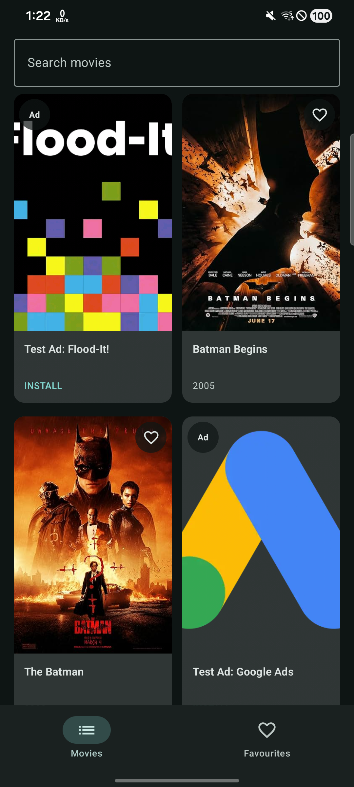
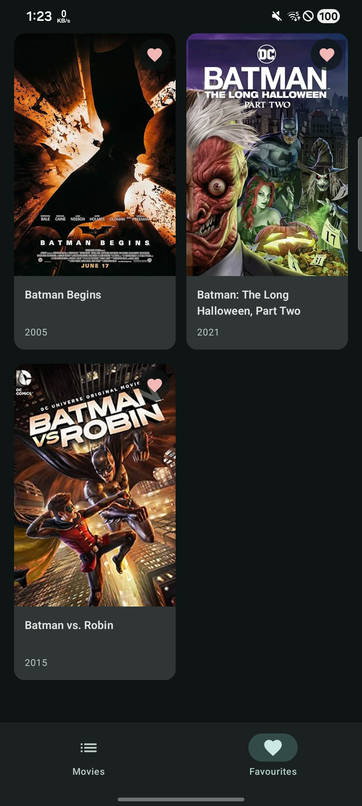
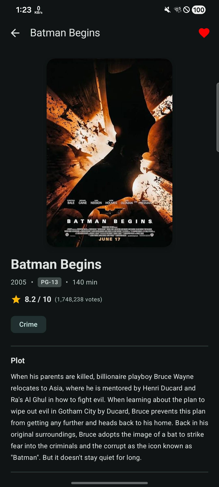
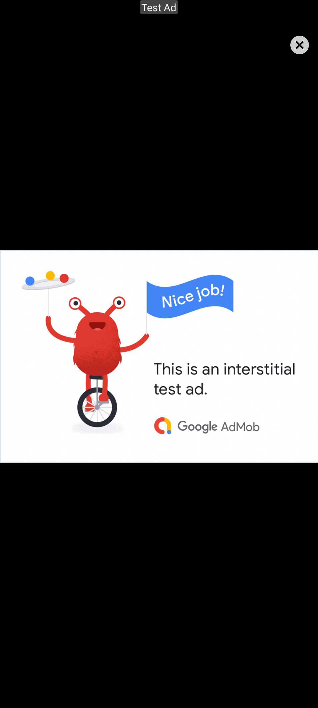

# Jeddy Movies

Android movie application developed as an assignment for **JeddyApps**, built with modern Android best practices: Jetpack Compose (Material 3), Clean Multi-Module Architecture, MVI, Paging 3, Room, Dagger Hilt, and Google Mobile Ads SDK.

---

## Screenshots

| Home (Native Ads in Grid) | Favourites Screen | Detail Screen | Interstitial Ad (Full Screen) |
|:---:|:---:|:---:|:---:|
|  |  |  |  |

---

## Features & Architecture

* **Multi-Module Clean Architecture**:
  * `:app` — Navigation, application class, and Hilt dependency injection.
  * `:feature:list` — Home search screen with debounced queries (350 ms) and Paging 3 infinite scrolling.
  * `:feature:favourites` — Local favourites persisted with Room, reactive heart icon states across tabs.
  * `:feature:detail` — Detailed movie metadata, ratings, genre chips, and plot with collapsible bottom bar animation.
  * `:core:network` / `:core:local` / `:core:ui` — Retrofit + OkHttp OMDb client, Room database, Material 3 design system.
  * `:domain` / `:data` — Domain models/usecases and repository implementation.
  * `:SDK` — Independent ad orchestration module.

---

## Ad Integration (`:SDK`)

Ad logic is isolated into a standalone library module with provider-agnostic contracts (`AdProvider`), currently implemented for Google AdMob (Next-Gen SDK):

1. **Native Ads in Movie Grid**:
   * Injected into the search results grid when at least 3 movies are loaded.
   * Ad cards match the exact dimensions, `2:3` poster aspect ratio, card shape, and typography of movie cards to maintain seamless visual consistency without jumping or layout shift.
   * Native Ad Validator overlay is suppressed in release builds via `setNativeValidatorDisabled()`.
2. **Fullscreen Interstitial Ad**:
   * Triggers strictly on the user's **second return to the app from the background** (Visit 1: launch, Visit 2: first return, Visit 3: second return).
   * Orchestrated via `ProcessLifecycleOwner` and persistent visit storage.

---

## Release

Pre-built, signed release APK is available:
* **GitHub Release**: [v1.0.0 Release & Download](https://github.com/mrdvbbr/JeddyApps_Assignment/releases/tag/v1.0.0)
* **Direct APK**: [`app/release/app-release.apk`](app/release/app-release.apk)
* Built with **R8 code minification**, **resource shrinking**, and ProGuard optimization.

To build locally:
```shell
./gradlew :app:assembleRelease
```

---

## Configuration & Setup

1. Add your OMDb API key in `local.properties`:
   ```properties
   OMDB_API_KEY=your_key_here
   ```
2. AdMob test ad units are configured by default. Custom production IDs can be provided in `local.properties`:
   ```properties
   ADMOB_APP_ID=your_admob_app_id
   ADMOB_INTERSTITIAL_AD_UNIT_ID=your_interstitial_id
   ADMOB_NATIVE_AD_UNIT_ID=your_native_id
   ```
